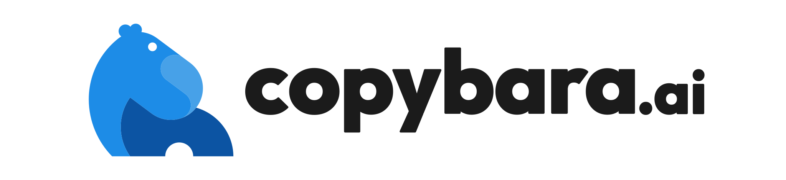

# Copybara Add-ons

<div align="center">



**Official browser extension and WordPress integrations for [Copybara](https://copybara.ai).**

[English](#english) · [Русский](#русский)

</div>

---

## English

### About Copybara

**Copybara** ([copybara.ai](https://copybara.ai)) is an AI-assisted content workspace. You can extract articles from the open web, refine and rewrite them in an AI editor, and publish the result to your own channels—including WordPress—without leaving your usual workflow.

### What this repository contains

| Component | Description |
| --- | --- |
| [`browser-extension/`](browser-extension/) | Extension for **Chrome**, **Edge**, and **Firefox**: send the current page to the Copybara AI editor in one click. |
| [`wordpress-plugin/copybara-ai-integration/`](wordpress-plugin/copybara-ai-integration/) | **copybara.ai Integration** — publish/update posts via REST or admin-ajax; WordPress 7 AI provider (Copybara / OpenRouter proxy). |
| [`playwright-e2e/`](playwright-e2e/) | Standalone **Playwright E2E** smoke tests for local UI checks and service log collection. Not included in production deploy. |

### Presentation: what the add-ons do

- **Browser extension** — On any normal `http`/`https` page, open the popup and use **Parse** (or equivalent). A new tab opens the Copybara AI editor with the page URL; parsing starts in the product. No extra copy-paste of links.
- **WordPress** — After you install the plugin, Copybara can push generated posts to your site (title, HTML body, optional image as featured and/or in body). Re-publish updates the same post. On WordPress 7+, Copybara can appear in **Settings → Connectors** as an AI provider. In WordPress use **Settings → copybara.ai**; in Copybara use **Settings → Publishing**.

### Download

| Method | Command / action |
| --- | --- |
| **Clone (HTTPS)** | `git clone https://github.com/vmoshikov/copybara-addons.git` |
| **Clone (SSH)** | `git clone git@github.com:vmoshikov/copybara-addons.git` |
| **ZIP (no Git)** | On GitHub: **Code → Download ZIP** |
| **Releases** | If [GitHub Releases](https://docs.github.com/en/repositories/releasing-projects-on-github/about-releases) are published, download the ZIP attached to a tag. |

Repository: [github.com/vmoshikov/copybara-addons](https://github.com/vmoshikov/copybara-addons).

### Use inside a larger monorepo (Git submodule)

From the Copybara monorepo root:

```bash
git submodule add https://github.com/vmoshikov/copybara-addons.git components/addons
git submodule update --init --recursive
```

### Installation (quick links)

- **Browser extension (load unpacked / development):** see [`browser-extension/README.md`](browser-extension/README.md).
- **Build a store ZIP:** from `browser-extension/`, run `./package.sh` (see the same README).
- **WordPress plugin:** upload the `wordpress-plugin/copybara-ai-integration/` folder or a ZIP of it via **Plugins → Add New → Upload Plugin**. Details: [`wordpress-plugin/copybara-ai-integration/README.md`](wordpress-plugin/copybara-ai-integration/README.md).
- **Playwright E2E add-on:** run local smoke tests from [`playwright-e2e/README.md`](playwright-e2e/README.md).

### Documentation and support

- Product: [copybara.ai](https://copybara.ai)
- Publishing / WordPress: [copybara.ai/docs/publishing](https://copybara.ai/docs/publishing)
- Extension store assets and policies: [`browser-extension/store/README.md`](browser-extension/store/README.md)

---

## Русский

### О сервисе Copybara

**Copybara** ([copybara.ai](https://copybara.ai)) — рабочее пространство для работы с контентом с поддержкой ИИ: можно брать материалы с открытого веба, дорабатывать и переписывать их в AI-редакторе и публиковать результат в ваши каналы — в том числе в WordPress — без лишних шагов.

### Что в этом репозитории

| Компонент | Описание |
| --- | --- |
| [`browser-extension/`](browser-extension/) | Расширение для **Chrome**, **Edge** и **Firefox**: отправить текущую страницу в AI-редактор Copybara одним кликом. |
| [`wordpress-plugin/copybara-ai-integration/`](wordpress-plugin/copybara-ai-integration/) | **copybara.ai Integration** (интеграция с copybara.ai): публикация/обновление постов; AI-провайдер WordPress 7 (прокси OpenRouter). |
| [`playwright-e2e/`](playwright-e2e/) | Отдельный набор **Playwright E2E** для локального smoke UI и сбора логов сервисов. В production-деплой не входит. |

### Презентация возможностей аддонов

- **Браузерное расширение** — на обычной странице `http`/`https` откройте всплывающее окно расширения и нажмите **«Спарсить»**. Откроется новая вкладка с AI-редактором Copybara с подставленным URL; парсинг запускается в продукте. Не нужно вручную копировать ссылку на статью.
- **WordPress** — после установки плагина Copybara может передавать сгенерированные посты на сайт (обложка и/или тело; повторная публикация обновляет ту же запись). На WordPress 7+ Copybara доступен в **Настройки → Connectors** как AI-провайдер. В WordPress: **Настройки → copybara.ai**; в Copybara: **Настройки → Публикация**.

### Скачивание

| Способ | Команда / действие |
| --- | --- |
| **Клонирование (HTTPS)** | `git clone https://github.com/vmoshikov/copybara-addons.git` |
| **Клонирование (SSH)** | `git clone git@github.com:vmoshikov/copybara-addons.git` |
| **ZIP без Git** | На GitHub: **Code → Download ZIP** |
| **Релизы** | Если включены [GitHub Releases](https://docs.github.com/en/repositories/releasing-projects-on-github/about-releases), скачайте ZIP к выбранному тегу. |

Репозиторий: [github.com/vmoshikov/copybara-addons](https://github.com/vmoshikov/copybara-addons).

### Использование в монорепозитории (submodule)

Из корня монорепозитория Copybara:

```bash
git submodule add https://github.com/vmoshikov/copybara-addons.git components/addons
git submodule update --init --recursive
```

### Установка (куда смотреть)

- **Расширение (режим разработчика / распакованное):** [`browser-extension/README.md`](browser-extension/README.md).
- **Сборка ZIP для магазинов:** в каталоге `browser-extension/` выполните `./package.sh` (подробности в том же README).
- **Плагин WordPress:** загрузите папку `wordpress-plugin/copybara-ai-integration/` или ZIP с ней через **Плагины → Добавить новый → Загрузить**. Подробнее: [`wordpress-plugin/copybara-ai-integration/README.md`](wordpress-plugin/copybara-ai-integration/README.md).
- **Playwright E2E аддон:** запуск локальных smoke-тестов в [`playwright-e2e/README.md`](playwright-e2e/README.md).

### Документация

- Сайт: [copybara.ai](https://copybara.ai)
- Публикация / WordPress: [copybara.ai/docs/publishing](https://copybara.ai/docs/publishing)
- Материалы для магазинов расширений: [`browser-extension/store/README.md`](browser-extension/store/README.md)
